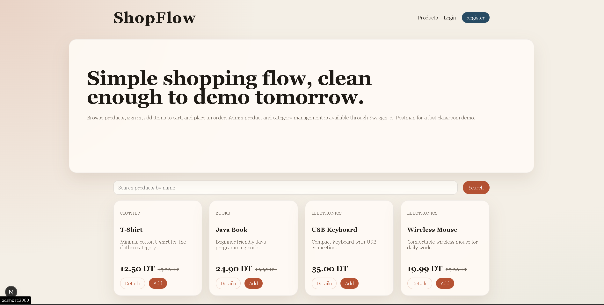
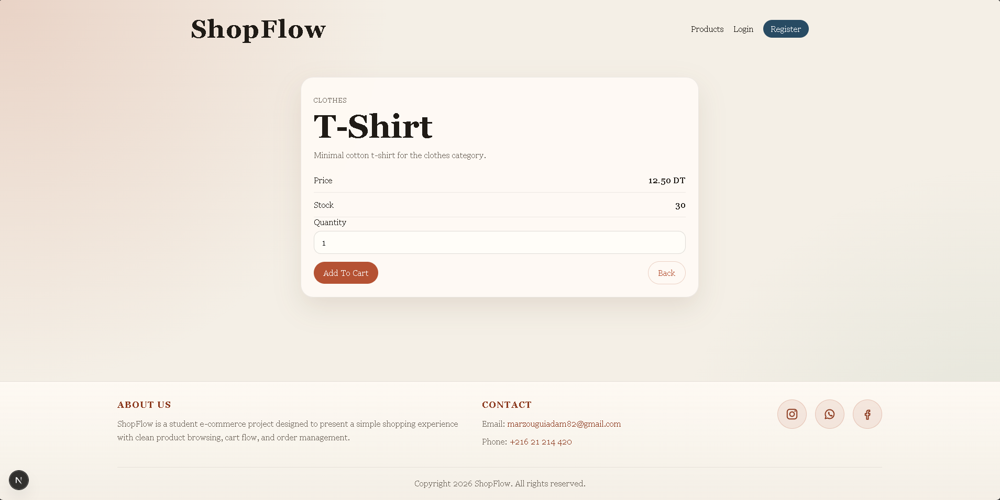
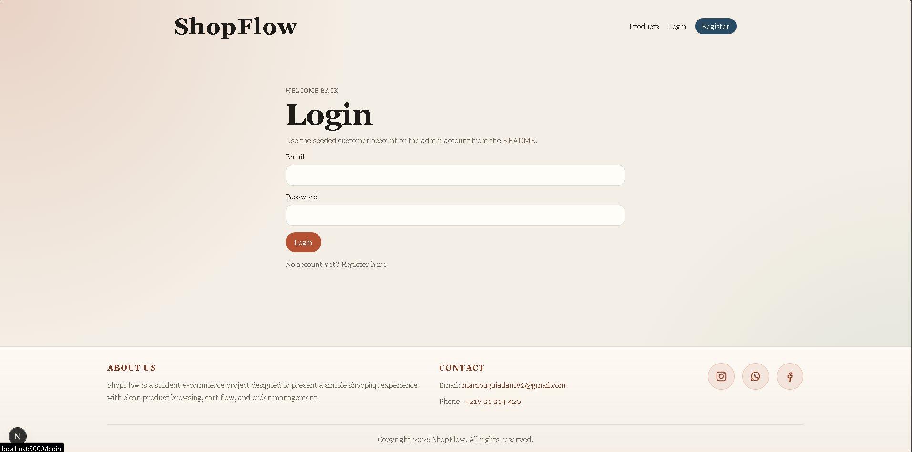

# ShopFlow Minimal MVP

ShopFlow is a simple e-commerce mini-project built for a fast local demo with:

- Spring Boot 3 + Java 17 + Maven
- Spring Security + JWT
- Spring Data JPA + H2
- Swagger / OpenAPI
- Next.js frontend with `fetch`

The goal is a clean MVP that is easy to run and explain in class.

## Project Structure

```text
Java/
├── backend/
│   ├── pom.xml
│   ├── src/main/
│   │   ├── java/com/shopflow/minimal/
│   │   │   ├── config/
│   │   │   ├── controller/
│   │   │   ├── dto/
│   │   │   ├── entity/
│   │   │   ├── exception/
│   │   │   ├── mapper/
│   │   │   ├── repository/
│   │   │   ├── security/
│   │   │   └── service/
│   │   └── resources/
│   │       ├── application.yml
│   │       ├── data.sql
│   │       └── schema.sql
│   └── src/test/
│       ├── java/com/shopflow/minimal/
│       │   └── ShopflowBackendIntegrationTest.java
│       └── resources/
│           └── application-test.yml
├── frontend/
│   ├── app/
│   ├── components/
│   ├── lib/
│   ├── public/
│   └── package.json
├── main.png
├── details.png
├── login.png
├── shopflow.postman_collection.json
└── README.md
```

## Features

- JWT authentication with register and login
- Roles: `ADMIN` and `CUSTOMER`
- Seeded demo users in `data.sql`
- Categories listing and admin creation
- Product listing with pagination and search
- Product details
- Admin create / update / soft delete product
- Customer cart with subtotal, shipping, and total
- Checkout into order
- Generated order number like `ORD-2026-00001`
- My orders list, details, and pending-order cancellation
- Swagger UI and Postman collection

## Screenshots

### Home Page



### Product Details



### Login Page



## Demo Accounts

- **Admin**
  - Email: `admin@shopflow.com`
  - Password: `Admin123!`
- **Customer**
  - Email: `client@shopflow.com`
  - Password: `Client123!`

## Run Backend

Requirements:

- Java 17
- Maven 3.9+

Commands:

```bash
cd backend
mvn spring-boot:run
```

Run tests:

```bash
cd backend
mvn clean test
```

Run from Eclipse:

- Right-click `ShopflowMinimalMvpApplication.java` -> **Run As** -> **Java Application**.

Quick demo option with the already-built jar:

```bash
cd backend
java -jar target/shopflow-minimal-mvp-0.0.1-SNAPSHOT.jar
```

If port `8080` is already used on your machine:

```bash
java -jar target/shopflow-minimal-mvp-0.0.1-SNAPSHOT.jar --server.port=8081
```

Backend URLs:

- API base: [http://localhost:8080](http://localhost:8080)
- Swagger UI: [http://localhost:8080/swagger-ui.html](http://localhost:8080/swagger-ui.html)
- H2 Console: [http://localhost:8080/h2-console](http://localhost:8080/h2-console)

H2 settings (default in-memory database):

- JDBC URL: `jdbc:h2:mem:shopflowdb`
- User: `sa`
- Password: empty

Optional MySQL configuration (via environment variables):

- `DB_URL`, `DB_DRIVER`, `DB_USERNAME`, `DB_PASSWORD`, `DB_DIALECT`

## Run Frontend

Requirements:

- Node.js 18+

Commands:

```bash
cd frontend
npm install
npm run dev
```

Frontend URL:

- App: [http://localhost:3000](http://localhost:3000)

Optional environment variable:

```env
NEXT_PUBLIC_API_BASE_URL=http://localhost:8080
```

## Fast Demo Flow

1. Open Swagger and show the available endpoints.
2. Login with `client@shopflow.com / Client123!` from the frontend.
3. Add products to cart.
4. Open cart and checkout.
5. Open My Orders and show the generated order number.
6. Cancel the order while it is still `PENDING`.
7. Login as admin in Swagger or Postman and create a category or product.

## Main API Endpoints

**Auth:**

- `POST /api/auth/register`
- `POST /api/auth/login`

**Products:**

- `GET /api/products?page=0&size=8`
- `GET /api/products/{id}`
- `POST /api/products`
- `PUT /api/products/{id}`
- `DELETE /api/products/{id}`

**Categories:**

- `GET /api/categories`
- `POST /api/categories`

**Cart:**

- `GET /api/cart`
- `POST /api/cart/items`
- `PUT /api/cart/items/{itemId}`
- `DELETE /api/cart/items/{itemId}`

**Orders:**

- `POST /api/orders`
- `GET /api/orders/my`
- `GET /api/orders/{id}`
- `PUT /api/orders/{id}/cancel`

## Notes

- Passwords seeded in `data.sql` use the `{noop}` prefix for speed in the demo environment.
- Registered users are stored with encoded passwords.
- Product deletion is soft delete only: `active = false`.
- Shipping is fixed at `5.00` when the cart is not empty.
- This project is intended for educational and local demonstration use, not production deployment.

## Project Files

- [Backend source](./backend/)
- [Frontend source](./frontend/)
- [Database schema](./backend/src/main/resources/schema.sql)
- [Seed data](./backend/src/main/resources/data.sql)
- [Postman collection](./shopflow.postman_collection.json)
